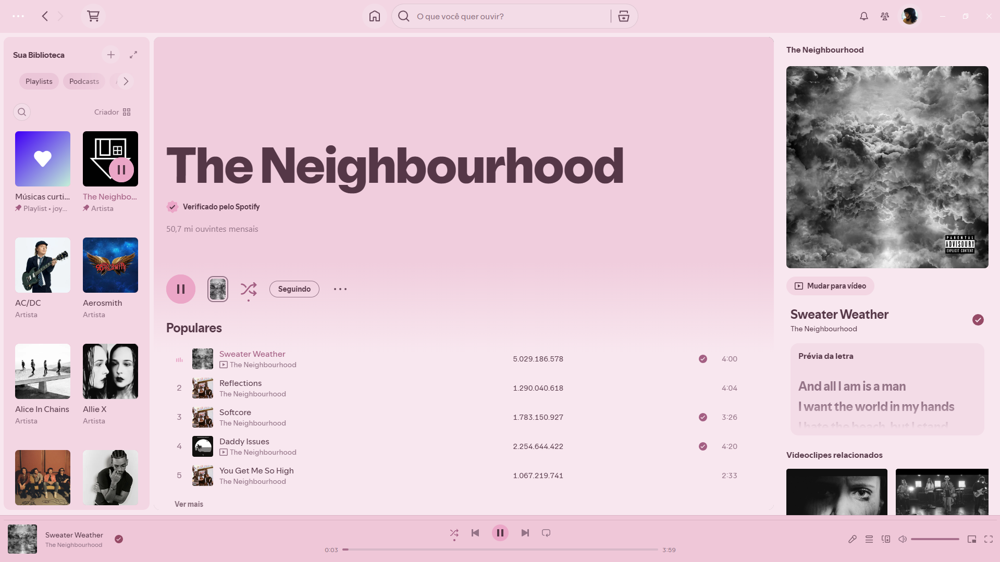
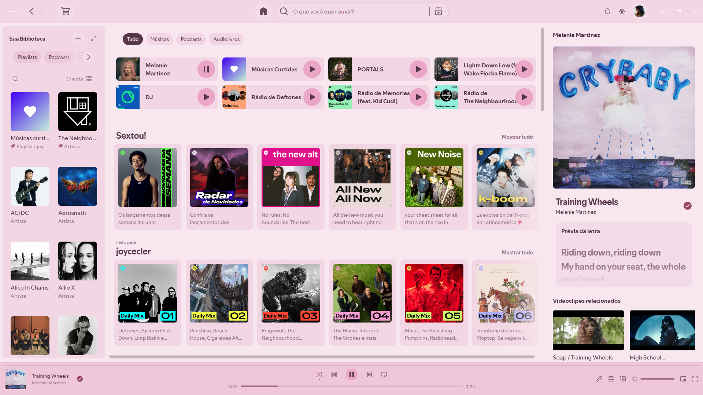

# pink spring 🌸

a soft pink + plum theme for spotify, made with [spicetify](https://spicetify.app).
flat, no shadows, no borders, just vibes 💗





## what's themed

- home, library, search and browse (category cards, carousels, filter chips)
- playlist / album / single headers with a soft pink gradient
- now playing panel (lyrics preview, music videos, about the artist, credits, queue)
- artist "about" modal (redesigned layout: ranking box, stats side by side, cities in a row)
- radio / watch feed modal
- every green bit i could find (play buttons, "now playing" bars, verified badges, toasts...) is pink now lol
- player bar, progress bar, volume, scrollbars
- even the equalizer graph in settings

## install

### via marketplace (easiest)
open the marketplace tab in spotify, go to **themes** and search for **pink spring**.

### manual
1. download `user.css` and `color.ini`
2. create a folder called **`PinkSpring`** (no spaces!) inside your spicetify themes folder:
   - **windows:** `%APPDATA%\spicetify\Themes\`
   - **linux / macos:** `~/.config/spicetify/Themes/`
3. put both files inside it
4. run:
   ```
   spicetify config current_theme PinkSpring color_scheme Base
   spicetify apply
   ```

## heads up

- tested on **windows**, with the desktop version of spotify (not the microsoft store one)
- the window buttons (close / minimize / maximize) and the `⋯` menu stay gray. those are drawn by windows itself, so no theme can touch them :/
- spotify updates sometimes break stuff. if something looks weird, open an issue with a screenshot and i'll fix it
- after a spotify update the theme might disappear. just run `spicetify backup apply`

## customizing

all the colors live at the top of `user.css`, in the `--ps-*` variables. change them and run `spicetify apply` 🎨

---

made with 💗 by joycecler
